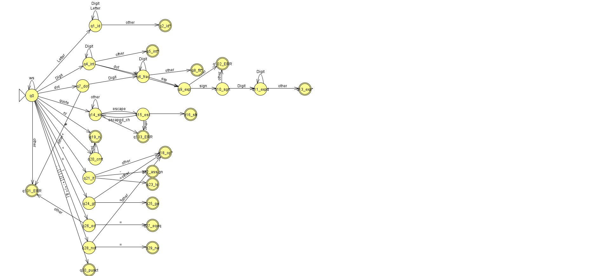

# RLite

Експериментальна мова програмування та набір інструментів розробки транслятора. Проєкт поєднує ергономіку мови R (оператор присвоєння `<-`, логічні константи `TRUE`/`FALSE`, конструктор векторів `c(...)`) зі строгою типізацією та підтримкою функціональних елементів.

Розроблено в межах навчального курсу "Основи розробки трансляторів" (КПІ ім. Ігоря Сікорського).

---

## Діаграма переходів лексера (ДКА)

Лексичний аналізатор спроєктовано як детермінований скінченний автомат з явною обробкою класів символів, поверненням нерозпізнаних символів у потік (`*`) та станами помилок:

<p align="center">
  
</p>

---

## Використання

### Розгортання virtual environment

```bash
python -m venv venv

# Windows Powershell:
.\venv\Scripts\Activate.ps1
# GNU/Linux:
source venv/bin/activate

pip install -r requirements.txt
```

### Запуск лексичного аналізатора (КП1)

```bash
python rlite_lexer.py test/test_base.rlite
```

### Запуск інтерактивного REPL

```bash
python repl.py
```

### Генерація моделі автомата для JFLAP

```bash
python generate_jflap.py
```